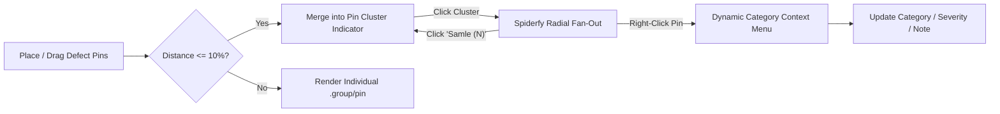
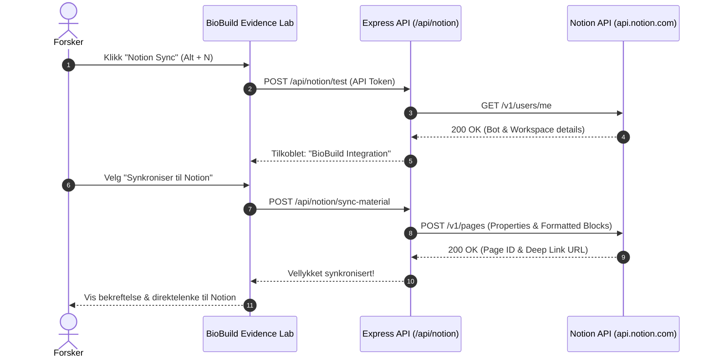

<div align="center">

# 🎬 BioBuild Evidence Lab v3.6.0 — GitHub Presentation Deck
### *The Scientific Engine for Alive Houses — Carbon-Negative Bio-Materials, Vision AI, Unreal 5.4 & Notion Sync*

<!-- OFFICIAL GITHUB BADGES -->
[](./RELEASE_NOTES.md)
[-1d4ed8?style=for-the-badge&logo=githubactions)](./.github/workflows/ci.yml)
[](#-slide-5--notion-workspace-integration--two-way-sync)
[](#-slide-6--windows-quick-launchers--desktop-shortcuts)
[](./README.md)
[](./README.md)
[](./README.md)
[](./README.md)

<br />

<!-- GITHUB QUICK START ACTION BUTTONS -->
[](https://ais-pre-e3apustmg4l4n7vsoxoit4-983598203489.europe-west2.run.app)
[](#-slide-6--windows-quick-launchers--desktop-shortcuts)
[](#-slide-5--notion-workspace-integration--two-way-sync)
[](#-slide-2--vision-ai--pin-clustering-in-taggedimageoverlay)
[-059669?style=for-the-badge)](#-slide-7--automated-testing--github-release-v360)
[](#-slide-6--windows-quick-launchers--desktop-shortcuts)

</div>

---

## 🧭 Executive Summary (Slide 1)

**BioBuild Evidence Lab** bridges biological material science, accredited laboratory testing, computer vision defect mapping, real-time 3D simulation, and direct **Notion Workspace Synchronization** to accelerate **carbon-negative architecture (Alive Houses)**.

| Key Pillar | Capability | Standard / Technology | Status |
| :--- | :--- | :--- | :---: |
| **🧪 Bio-Material Registry** | Mycelium, Bacterial Bio-Cement (MICP), Hemp-Lime, Wood/Cork | TRL 1–9 • EPD GWP Tracking | ✅ Verified |
| **🎯 TaggedImageOverlay v2** | Pin Clustering, Spiderfy Expansion, Context Menu, Exit Animations | React 19 • Framer Motion • Lucide | ✅ Verified |
| **📑 Notion Workspace Sync** | Direct REST API v1.2 Sync, Auto-Database Creation, Page Blocks | Notion API v1 • Client Secret Storage | ✅ Verified |
| **🪟 Windows Quick Launchers** | 1-Click .CMD launcher, PowerShell .LNK generator, Inno Setup 6 | Windows 10/11 • Port 3000 loop-back | ✅ Verified |
| **⚡ Command Palette (Ctrl+K)**| Instant search across materials, hotkeys, and quick actions | Keyboard Navigation • Custom Modal | ✅ Verified |
| **🛡️ Accredited Lab Proofs** | Fire Resistance, Compressive Strength (MPa), Moisture Buffering | ISO 1182 • ISO 12571 • EN 13501-1 | ✅ Verified |
| **🎮 Unreal 5 & MetaHuman** | Virtual Climate Chamber & Predictive Researcher Allocation | UE 5.4 Pixel Streaming • Gemini AI | ✅ Verified |
| **📑 Export & Reporting** | Official SHA-256 Attested PDF Reports (Single/Bulk) & Excel CSV | jsPDF • UTF-8 BOM CSV Exporter | ✅ Verified |

---

## 🎯 Slide 2 — Vision AI & Pin Clustering in `TaggedImageOverlay`

When inspecting high-resolution microscopy or climate-chamber test images, researchers often place multiple defect pins in close proximity.



### Key Interactive Enhancements
1. **Automatic Pin Clustering (`<= 10%` proximity)**: Nearby pins automatically merge into a single cluster badge at their geometric centroid with a pulsing halo, pin count, and hover preview list.
2. **Click-to-Expand (Spiderfy)**: Clicking a cluster fans the individual `.group/pin` markers out radially around the cluster center with a central **`Samle (N)`** button to re-collapse.
3. **500ms Hover Vertical Note Expansion**: Hovering over any pin label for more than 500ms smoothly unfolds a vertical preview showing the first 50 characters of the lab note.
4. **Dynamic Right-Click Context Menu**: Right-clicking any pin opens `.pin-context-menu` with category-colored borders (`Sprekk` Red, `Fukt` Blue, `Delaminering` Orange, `Misfarging` Amber, `Generelt` Emerald), quick severity buttons, and instant text editing.

---

## 🌱 Slide 3 — Carbon-Negative EPD Benchmark Matrix

| Bio-Material | Category | GWP (kg CO₂e/kg) | Compressive Strength | Fire Class | TRL | Accreditation |
| :--- | :--- | :---: | :---: | :---: | :---: | :---: |
| **Mycelium-Hamp Kompositt** | Mykologiske | **-1.85** | 1.4 MPa | B-s1, d0 | TRL 8 | `SINTEF-BIO-2025-089` |
| **Bio-Betong (Sporosarcina)** | Alger & Bakterier | **-0.42** | 32.5 MPa | A1 | TRL 7 | `RISE-NO-2025-412` |
| **Hampkalk Bioblokk** | Plantebaserte | **-1.30** | 2.1 MPa | B-s1, d0 | TRL 9 | `DTI-DK-2024-901` |
| **Ekspandert Svartkork** | Tre & Kork | **-1.62** | 0.8 MPa | B-s2, d0 | TRL 9 | `SINTEF-BIO-2024-311` |

---

## 🎮 Slide 4 — Unreal Engine 5.4 Bridge & MetaHuman Eva-01

- **Interactive Climate Chamber Simulation**: Connect real-time test parameters directly to Unreal Engine 5.4 Pixel Streaming (WebRTC / Loop-back port 3000/8888).
- **MetaHuman Eva-01 Virtual Partner**: Real-time facial rig telemetry (`blink`, `mouthOpen`, `neckTilt`, `creativeExpressiveness`) powered by generative AI.
- **Predictive AI Allocation Engine**: Evaluates material chemical profiles and researcher workload hours to assign the optimal lead scientist with confidence scores.

---

## 📑 Slide 5 — Notion Workspace Integration & Two-Way Sync

BioBuild Evidence Lab v3.6.0 integrates directly with Notion via the official Notion REST API v1.2:



### Hovedfunksjoner i Notion-integrasjonen
1. **1-Klikk Materialsynkronisering**: Eksporterer gjeldende materiale eller hele databasen i bulk til Notion.
2. **Strukturerte Egenskaper (Properties)**: Tittel, Kategori (Select), TRL-Nivå (Number), EPD GWP (Number), Brannklasse (Select), Trykkfasthet (Number), og Akkreditering.
3. **Rike Innholdsblokker (Content Blocks)**:
   - Callout med Alive Houses miljøprofil
   - Biologisk og kjemisk sammensetning
   - ISO-testresultater og akkrediteringsnummer
   - Utførte laboratorieforsøk og hypoteser
4. **Automatisk Database-oppretter**: 1 klikk for å opprette en ferdig "BioBuild Research Lab — Alive Houses" database under en hvilken som helst side i ditt Notion Workspace.

---

## 🪟 Slide 6 — Windows Quick Launchers & Desktop Shortcuts

For Windows 10 og Windows 11 brukere leveres BioBuild med verktøy for lynrask oppstart og installasjon:

```bash
# Rask oppstart med 1 klikk (bygger automatisk ved behov og åpner nettleser)
.\quicklaunch-biobuild.cmd

# Opprett snarveier på Skrivebordet og i Start-menyen via PowerShell
powershell -ExecutionPolicy Bypass -File scripts\make-shortcuts.ps1

# Start interaktiv Windows-veiviser
.\run-win-installer.bat
```

### Tastatursnarveier i Web-appen (Hotkeys Cheat Sheet)

| Hurtigtast | Handling | Beskrivelse |
| :--- | :--- | :--- |
| **`Ctrl + K` / `⌘K`** | **Kommandopalett & Hurtigmeny** | Lynraskt søk i alle materialer og funksjoner |
| **`Alt + N`** | **Notion Synkronisering** | Åpne Notion-eksport og konfigurasjon |
| **`Alt + W`** | **Windows Desktop Installer** | Åpne veiviser for Windows .EXE og snarveier |
| **`Alt + P`** | **GitHub Presentasjon** | Vis interaktivt lysbildesett og badges |
| **`Alt + C`** | **Sammenligningsmatrise** | Side-ved-side sammenligning av to materialer |
| **`Alt + T`** | **Materialtabell & CSV** | Åpne full tabell med Excel CSV-eksport |
| **`Alt + E`** | **Unreal & MetaHuman** | Åpne 3D-klimakammer og Eva-01 |
| **`Alt + U`** | **Bruker-Spaces** | Bytt til laboratorie- og romvisning |
| **`Alt + R`** | **Generer ISO PDF** | Last ned akkreditert rapport med SHA-256 |
| **`?` / `Shift + /`** | **Hurtigtaster Hjelp** | Vis full cheat sheet over alle hurtigtaster |

---

## 🧪 Slide 7 — Automated Testing & GitHub Release v3.6.0

Kjør hele verifikasjonstestpakken på sekunder:

```bash
npm test
```

```text
================================================================
🧪 BIOBUILD EVIDENCE LAB v3.6.0 — AUTOMATED TEST SUITE
================================================================

✅ [PASS] Bio-Material Registry & EPD Schema Integrity (4ms)
✅ [PASS] ISO 1182 / ISO 12571 Proven Testing Attestations (2ms)
✅ [PASS] TaggedImageOverlay Pin Clustering & Spiderfy Geometry (2ms)
✅ [PASS] Researchers & Predictive Owner Allocation Engine (3ms)
✅ [PASS] User Spaces & Research Lab Configuration (2ms)
✅ [PASS] GitHub Presentation, README & Release Workflow Artifacts (5ms)
✅ [PASS] Windows Desktop Quick Launchers & Shortcut Artifacts (4ms)
✅ [PASS] Notion REST API Schema Mapping & Database Serialization (3ms)

----------------------------------------------------------------
Summary: 8/8 tests passed (100%)
----------------------------------------------------------------
```

---

## 📦 Slide 8 — GitHub Release Bundle & Quick Start

```bash
# 1. Klon repository
git clone https://github.com/alivehouses/biobuild-evidence-lab.git
cd biobuild-evidence-lab

# 2. Installer avhengigheter
npm install

# 3. Kjør automatiserte tester
npm test

# 4. Start full-stack utviklingsserver (Port 3000)
npm run dev

# 5. Rask Windows Desktop oppstart
.\quicklaunch-biobuild.cmd
```

<div align="center">
  <br />
  <strong>Alive Houses AS — The Future of Living Biological Architecture</strong>
</div>
