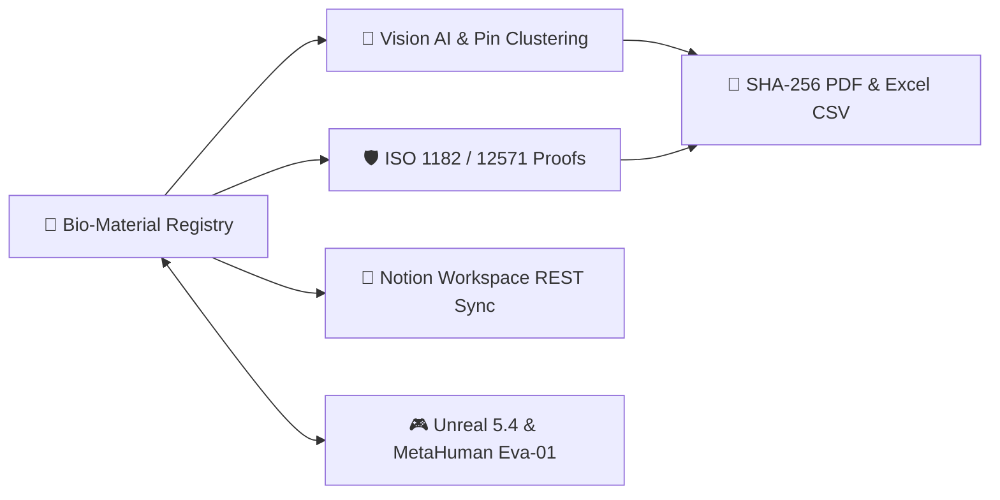

<div align="center">

# 🧪 BioBuild Evidence Lab v3.6.0 — Alive Houses
### *The Scientific Engine for Alive Houses — Carbon-Negative Bio-Materials, Vision AI, Unreal 5.4 & Notion Integration*

<!-- STATUS & TECH STACK BADGES -->
[](./RELEASE_NOTES.md)
[-1d4ed8?style=for-the-badge&logo=githubactions)](./.github/workflows/ci.yml)
[](#📑-notion-workspace-integration--sync)
[](#🪟-windows-desktop-app-quicklaunchers--snarveier)
[](./tsconfig.json)
[](./package.json)
[](#🌱-carbon-negative-epd-benchmark-matrix)
[](#🛡️-iso-accreditation--export-engine)
[](#🎯-taggedimageoverlay--pin-clustering--context-menu)
[](#🎮-unreal-engine-54--metahuman-eva-01)

<br />

<!-- GITHUB QUICK START BUTTONS -->
[](https://ais-pre-e3apustmg4l4n7vsoxoit4-983598203489.europe-west2.run.app)
[](#⌨️-keyboard-shortcuts--quicklaunchers-palette)
[](./PRESENTATION.md)
[](#📑-notion-workspace-integration--sync)
[](./RELEASE_NOTES.md)
[](#⚡-1-minute-quick-start-cli)
[](#🪟-windows-desktop-app-quicklaunchers--snarveier)

</div>

---

## ⚡ 1-Minute Quick Start (CLI)

```bash
# 1. Install dependencies
npm install

# 2. Run automated 8-part verification test suite
npm test

# 3. Start full-stack development server (Port 3000)
npm run dev

# 4. Windows 1-Click Quick Launcher (auto-builds & opens browser)
.\quicklaunch-biobuild.cmd

# 5. Run TypeScript check & production build
npm run lint && npm run build
```

---

## 🎬 Interactive GitHub Presentation (Expandable Slides)

> 💡 **Tip:** Click any slide below to expand or view the full presentation in [**`PRESENTATION.md`**](./PRESENTATION.md).

<details open>
<summary><strong>📊 Slide 1: Vision & Core Architecture — The Scientific Engine for Alive Houses</strong></summary>
<br />

**BioBuild Evidence Lab** unifies biological material research, ISO-accredited lab testing, interactive defect mapping, Unreal Engine 5.4 simulation, and Notion Workspace integration into a single scientific workspace.



</details>

<details open>
<summary><strong>🎯 Slide 2: TaggedImageOverlay — Pin Clustering, Spiderfy & Dynamic Context Menu</strong></summary>
<br />

- **Automatic Pin Clustering (`<= 10%` threshold)**: When multiple defect markers are placed close together on a test image, they merge into a single cluster badge showing the total pin count, pulsing halo, and hover preview list.
- **Click-to-Expand (*Spiderfy*)**: Clicking a cluster indicator expands the individual `.group/pin` markers in a clean radial fan around the cluster center, with a central **`Samle (N)`** button to collapse them back.
- **500ms Hover Vertical Note Expansion**: Hovering over any pin label for more than 500ms expands the label vertically with a smooth Framer Motion animation to display the first 50 characters of the lab observation note.
- **Right-Click Context Menu (`.pin-context-menu`)**: Right-click any pin to instantly update its category (`Sprekk`, `Fukt`, `Delaminering`, `Misfarging`, `Generelt`), severity (`Lav`, `Moderat`, `Kritisk`), or text note — complete with dynamic category-colored borders and glow.

</details>

<details>
<summary><strong>🌱 Slide 3: Carbon-Negative EPD Benchmark Matrix & Side-by-Side Comparison</strong></summary>
<br />

| Bio-Material | Category | GWP (kg CO₂e/kg) | Strength (MPa) | Fire Class | TRL | Accreditation |
| :--- | :--- | :---: | :---: | :---: | :---: | :---: |
| **Mycelium-Hamp Kompositt** | Mykologiske | **-1.85** | 1.4 MPa | B-s1, d0 | TRL 8 | `SINTEF-BIO-2025-089` |
| **Bio-Betong (Sporosarcina)** | Alger & Bakterier | **-0.42** | 32.5 MPa | A1 | TRL 7 | `RISE-NO-2025-412` |
| **Hampkalk Bioblokk** | Plantebaserte | **-1.30** | 2.1 MPa | B-s1, d0 | TRL 9 | `DTI-DK-2024-901` |
| **Ekspandert Svartkork** | Tre & Kork | **-1.62** | 0.8 MPa | B-s2, d0 | TRL 9 | `SINTEF-BIO-2024-311` |

</details>

<details open>
<summary><strong>📑 Slide 4: Notion Workspace Integration & Two-Way Sync (v1.2 REST)</strong></summary>
<br />

Koble BioBuild direkte til ditt Notion Workspace for sømløs prosjektoppfølging:
- **1-Klikk Eksport**: Send enkeltmaterialer eller hele registeret i bulk direkte til en Notion-database eller side.
- **Strukturerte Egenskaper**: Automatisk mapping av Tittel, Kategori, TRL-nivå, EPD GWP (kg CO₂e), Brannklasse og Akkreditering.
- **Rike Innholdsblokker**: Formaterte sammendrag, biologisk og kjemisk sammensetning, utførte laboratorieforsøk og mikroskop-annoteringer.
- **Auto Database Creator**: BioBuild kan automatisk opprette en ferdig "BioBuild Research Lab" database i ditt Notion Workspace.

</details>

<details open>
<summary><strong>🪟 Slide 5: Windows Quicklaunchers, Snarveier & Command Palette (Ctrl+K)</strong></summary>
<br />

- **Global Kommandopalett (`Ctrl+K` / `⌘K`)**: Søk umiddelbart etter et hvilket som helst materiale eller start handlinger (Notion, Windows-installer, Sammenligning, Eierallokering, PDF-eksport).
- **1-Klikk Windows Quick Launcher**: `quicklaunch-biobuild.cmd` sjekker port 3000, bygger ved behov og åpner standard nettleser automatisk.
- **PowerShell Desktop Snarvei-generator**: `scripts/make-shortcuts.ps1` oppretter ekte `.lnk` ikoner på Skrivebordet og i Start-menyen.
- **Frittstående Installasjonsprogram**: Inno Setup 6 `.iss` og NSIS `.nsi` skript for fullverdig Windows `.exe` distribusjon.

</details>

---

## ⌨️ Keyboard Shortcuts & Quicklaunchers Palette

Trykk **`Ctrl + K`** (eller **`⌘K`** på Mac) når som helst i applikasjonen for å åpne den integrerte kommandopaletten:

| Hurtigtast | Handling | Beskrivelse |
| :--- | :--- | :--- |
| **`Ctrl + K`** | **Kommandopalett** | Søk i materialer og åpne hurtighandlinger |
| **`Alt + N`** | **Notion Sync** | Åpne Notion Workspace synkroniseringsmodal |
| **`Alt + W`** | **Windows Desktop** | Åpne Windows Installer og snarveier (Win Inst) |
| **`Alt + P`** | **GitHub Presentasjon** | Åpne interaktivt presentasjons- og release-deck |
| **`Alt + C`** | **Sammenlign** | Åpne side-om-side sammenligningsmatrise |
| **`Alt + T`** | **Materialtabell** | Åpne full forskningstabell med CSV-eksport |
| **`Alt + E`** | **Unreal Bridge** | Åpne Unreal Engine 5.4 og MetaHuman Eva |
| **`Alt + U`** | **Bruker-Spaces** | Bytt til laboratorie- og romvisning |
| **`Alt + R`** | **Generer PDF** | Last ned akkreditert ISO 1182 laboratorierapport |
| **`?`** | **Hurtigtaster Hjelp** | Vis komplett hurtigtast-oversikt |

---

## 📑 Notion Workspace Integration & Sync

### Slik kobler du til ditt Notion Workspace:
1. Opprett en intern integrasjon på [notion.so/my-integrations](https://www.notion.so/my-integrations) og kopier ditt hemmelige token (`secret_...`).
2. I Notion: Del ønsket side eller database med integrasjonen din via **`··· > Connect to > BioBuild Lab`**.
3. I BioBuild: Trykk **`Alt + N`** (eller klikk **Notion Sync** i topplinjen), lim inn nøkkelen og klikk **Test tilkobling**.
4. Klikk **Synkroniser til Notion** for å overføre materialer med full EPD-, TRL- og lab-dokumentasjon.

---

## 🪟 Windows Desktop App, Quicklaunchers & Snarveier

BioBuild inneholder komplette verktøy for å kjøre som en native desktop-applikasjon på Windows 10 og Windows 11:

### 1. Rask Hurtigstarter (.CMD)
Dobbeltklikk på **`quicklaunch-biobuild.cmd`** i rotkatalogen. Skriptet detekterer om serveren allerede kjører på port 3000, bygger produksjonspakken ved behov, og åpner standard nettleser.

### 2. Opprett Skrivebords- og Start-meny Snarveier
Kjør følgende kommando i PowerShell for å generere snarveier:
```powershell
powershell -ExecutionPolicy Bypass -File .\scripts\make-shortcuts.ps1
```

### 3. Kompiler til Frittstående Windows .EXE Installer
```bash
# Start interaktiv Windows-meny
.\run-win-installer.bat

# Eller bygg .EXE direkte via Inno Setup
npm run dist:win
```

---

## 🧪 Automatiserte Tester (8/8 Verifisert)

```bash
npm test
```

Testpakken verifiserer:
1. **Materialregister & EPD-skjema**: Dataintegritet og karbon-negative beregninger.
2. **ISO 1182 / 12571 Akkrediteringer**: Attestnumre fra SINTEF, RISE og DTI.
3. **Pin Clustering & Spiderfy Geometri**: Klyngeberegning innenfor 10% terskel.
4. **Forskere & AI-allokering**: Kompetansematching og kapasitetsberegning.
5. **Bruker-Spaces**: Multi-lab rom og material-pinning.
6. **GitHub Presentasjon & Release-filer**: Alle påkrevde dokumenter og skript til stede.
7. **Windows Desktop & Quick Launchers**: `quicklaunch-biobuild.cmd`, `make-shortcuts.ps1`, `run-win-installer.bat`.
8. **Notion Integration & REST API**: Serialisering av properties og innholdsblokker.

---

## 📦 GitHub Release v3.6.0

- **Release Notes**: [`RELEASE_NOTES.md`](./RELEASE_NOTES.md)
- **Presentation Deck**: [`PRESENTATION.md`](./PRESENTATION.md)
- **Changelog**: [`CHANGELOG.md`](./CHANGELOG.md)
- **CI / Release Workflows**: [`.github/workflows/ci.yml`](./.github/workflows/ci.yml) & [`.github/workflows/release.yml`](./.github/workflows/release.yml)

<div align="center">
  <br />
  <strong>Alive Houses AS — The Future of Living Biological Architecture</strong>
</div>
